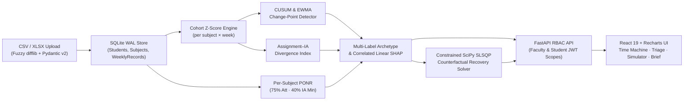

<div align="center">

# PulseGrid

### Cohort-Calibrated Academic Early-Warning & Counterfactual Recovery Engine

[](backend/tests)
[](frontend/e2e)
[](backend/ml/artifacts/model_audit.json)
[](backend/ml/artifacts/model_audit.json)
[](#architecture)

*Catch silent academic decline weeks early, eliminate exam-shock false alarms through cohort Z-score normalization, compute per-subject Point-of-No-Return (PONR) cliffs, and prescribe minimum-effort policy-constrained recovery plans.*

[Quickstart](#quickstart) • [Architecture](#architecture) • [Hero Demo Personas](#seeded-hero-personas-stu-001--stu-004) • [Model Audit](#leakage-free-model-benchmark--calibration) • [Verification](#verification)

</div>

---

## Why PulseGrid?

Traditional LMS dashboards rely on static thresholds (`< 60%` marks or `< 75%` attendance). Those naive rules fail in two expensive ways:

| Scenario | Naive Static Threshold (`< 60%` / `< 75%`) | PulseGrid Cohort-Calibrated Engine |
|---|---|---|
| **Hard Cohort-Wide Exam** (`CS201` Wk 5 `-20` pt shock, `MA101` Wk 8 `-18` pt shock) | Floods advisors with false alarms across `ON_TRACK` students | Normalizes per `(subject_id, week)` (`z ≈ 0.0σ`) → **0 `ON_TRACK` false alarms** |
| **Silent High-Baseline Slip** (`STU-001` drops from `89%` → `58%` starting Wk 6–7) | Semester cumulative average stays `> 80%` until weeks later | One-sided CUSUM detects sustained negative shift at **Week 7** |
| **Take-Home vs. Closed-Book Gap** (`STU-002` `94%` assignments vs `36%` closed-book IA) | Composite average masks concept failure (`> 64%`) | Divergence Index (`z_assign - z_internal = +3.42σ`) flags **Passive Copier Gap** |
| **Actionable Recovery** | Generic "improve marks" warning | Constrained SciPy `SLSQP` solver enforces `≥ 75%` attendance PONR & `≥ 40%` per-subject IA floors |

---

## Architecture



---

## Key Capabilities

- **Week 4–9 Time Machine Scrubber & Engine Toggle (`GET /api/v1/dashboard/time-machine`):** Step week-by-week (with 1.2s Replay autoplay) and toggle live between **PulseGrid (Cohort-Calibrated)** and **Naive Static (`<60%`)** on both the Faculty Dashboard and 2×2 Triage Matrix (with a white beacon ring tracking `STU-001` Aarav Kulkarni).
- **Dynamic Active Week & Policy Alignment:** Automatically infers `active_week` (`COALESCE(MAX(week), CURRENT_WEEK)`) across `/health`, `/dashboard/summary`, PONR deadlines, and remaining What-If simulation weeks, paired with clear session margin formatting (`1 missable session (~4d margin)`).
- **Correlation-Dependent Linear SHAP + 5-Bucket Domain Grouping:** Handles collinear academic indicators via `shap.LinearExplainer(..., feature_perturbation="correlation_dependent")` and preserves additive invariance across 5 grouped buckets with a **`Grouped Factors` | `Raw 20 Features`** UI toggle.
- **Multi-Label Root-Cause Diagnosis:** Resolves `primary_archetype` (`DETENTION_CLIFF`, `PASSIVE_COPIER_CONCEPT_GAP`, `SILENT_SLIPPER`, `BROAD_DISENGAGEMENT`, `CONCEPTUAL_STRUGGLER`, `ON_TRACK`) alongside `secondary_flags` (`+N` queue badges and header tags).
- **Policy-Constrained Counterfactual Simulator (`POST /api/v1/simulate`):** Shares a unified `project_features_for_whatif()` engine with `recovery_solver.py`, uses persisted real cohort mean/std statistics, distinguishes `historical_cusum_triggered` vs. `projected_cusum_active`, enforces hard 75% attendance / 40% per-subject IA feasibility bounds, and flags `requires_waiver=True` when recovery is mathematically impossible without waiver.
- **Two-Step Transactional CSV/XLSX Ingestion & 1-Click Demo Reset:** Fuzzy column alignment preview (`commit=false`), atomic batch upsert + incremental snapshot rebuild (`commit=true`), sample CSV export, and faculty-only `/api/v1/admin/reset-demo` restoration (`DEMO_MODE=true`).
- **URL-Synced SPA Routing, Inline Intervention Drawer & Printable Brief:** Supports deep linking and page refreshes (`/faculty/students/STU-001`), slide-over intervention logging directly from Student Detail, and light-mode SVG trajectory rendering for PDF/print briefs.

---

<details>
<summary><strong>Seeded Hero Personas (<code>STU-001</code> – <code>STU-004</code>) Interactive Walkthrough</strong></summary>

<br/>

| ID | Roll No | Student | Primary Archetype (+ Flags) | Live Demo Signal at Week 9 | Suggested UI Path |
|---|---|---|---|---|---|
| `1` | `STU-001` | **Aarav Kulkarni** | `SILENT_SLIPPER` | Drops from ~89% baseline; **CUSUM fires Week 7** while cumulative marks stay `> 77%` | `/faculty/students/STU-001` → Time Machine Wk 7 |
| `2` | `STU-002` | **Meera Nair** | `PASSIVE_COPIER_CONCEPT_GAP` + `CONCEPTUAL_STRUGGLER` | ~94% assignments vs ~36% closed-book IA (**`+3.42σ`** divergence, `CRITICAL`) | `/faculty/students/STU-002` → SHAP Waterfall |
| `3` | `STU-003` | **Rohan Deshmukh** | `DETENTION_CLIFF` | `CS301L` CN Lab at 12/18 (`66.7%`, `1 missable session (~4d margin)` → `WINDOW_CLOSING`) | Role Switch → Student (`STU-003`) → Simulator |
| `4` | `STU-004` | **Priya Sharma** | `ON_TRACK` (Recovered) | Logged Week 7 intervention shows `AT_RISK → SAFE` **`LIFT IMPROVED`** badge | Faculty → Interventions |

</details>

<details>
<summary><strong>Leakage-Free Model Benchmark & Calibration (Weeks 1–8 → Weeks 10–12)</strong></summary>

<br/>

Models are trained strictly on Weeks `1–8` observational features to predict Weeks `10–12` standing (no demographics or target leakage; enforced by `backend/tests/test_anti_leakage.py`):

| Metric | Value | Notes |
|---|---|---|
| **Selected Classifier** | `LogisticRegression` | Chosen by 5-fold stratified CV `(recall, macro_f1)` |
| **5-Fold CV At-Risk Recall** | `96.7% ± 2.7%` | Stratified 5-fold out-of-fold evaluation (`n=240`) |
| **Holdout At-Risk Recall** | `91.3%` | Unseen 25% holdout (`n=60`, `SEED=42`) |
| **Holdout ROC AUC (OvR)** | `0.857` | Multi-class OvR across `SAFE`, `WATCH`, `AT_RISK`, `CRITICAL` |
| **At-Risk Probability Brier Score** | `0.0196` | 5-bin quantile reliability curve rendered in Model Audit tab |
| **Continuous Regressor MAE** | `3.403 pts` | `GradientBoostingRegressor` under Week 9–12 stochasticity & ~8% regime shifts |

</details>

<details>
<summary><strong>Canonical Routes, RBAC & Tech Stack Details</strong></summary>

<br/>

- **Backend:** FastAPI, SQLAlchemy 2.0, Alembic, SQLite (WAL mode), Pydantic v2, PyJWT, NumPy, SciPy (`SLSQP`), Pandas, scikit-learn, SHAP, OpenPyXL
- **Frontend:** React 19, TypeScript, Vite, Tailwind CSS, Recharts, TanStack React Query, `openapi-typescript`, Lucide Icons
- **Canonical Routes:**
  - **Faculty (`require_faculty`):** `/faculty/dashboard`, `/faculty/triage`, `/faculty/students/:id` (accepts ID or roll e.g. `STU-001`), `/faculty/interventions`, `/faculty/upload`, `/faculty/model-audit`
  - **Student (`assert_student_scope`):** `/student/home`, `/student/recovery`, `/student/brief`

</details>

---

## Quickstart

### 1. Environment Setup
```bash
cp .env.example .env
```
*(In local development, `DEMO_MODE=true` enables signed demo role-switching tokens while enforcing strict `401`/`403` RBAC and student-row scoping across all endpoints.)*

### 2. One-Command Startup (Linux / macOS / Git Bash)
```bash
bash start.sh
```

### 3. Windows PowerShell Runbook
```powershell
# Terminal 1 — Seed, Train, Build Cache & Launch Backend
cd backend
python ml/generate_data.py
python ml/train_and_evaluate.py
python -m alembic upgrade head
python -m uvicorn app.main:app --host 127.0.0.1 --port 8011

# Terminal 2 — Build & Preview Frontend
cd frontend
npm install
npm run build
$env:VITE_PROXY_TARGET = "http://127.0.0.1:8011"
npm run preview -- --host 127.0.0.1 --port 4173
```
Open **http://127.0.0.1:4173** in your browser. *(Use `--port 8000` if port `8000` is unbound on your machine.)*

---

## Verification

```powershell
# Backend lint + full test suite (117 tests)
cd backend
python -m ruff check app/ tests/ ml/ alembic/versions/002_add_secondary_flags.py alembic/versions/003_add_weekly_timeline_cache.py
python -m pytest -q

# Frontend typecheck, build & Playwright E2E suite (5 specs, preview running on 4173)
cd ..\frontend
npx tsc --noEmit
npm run build
npx playwright test e2e/ --reporter=list
```
